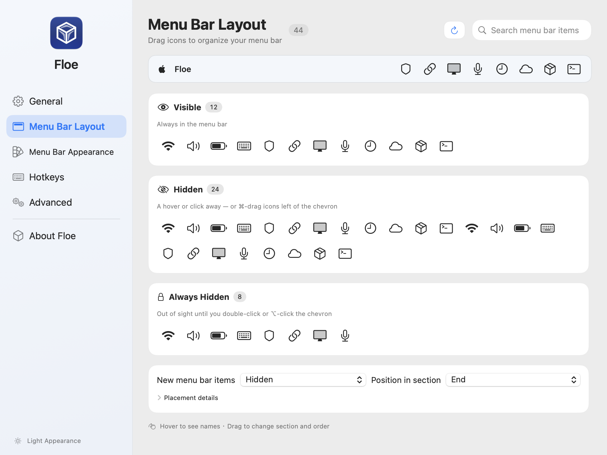

[English](README.md) · [简体中文](README.zh-CN.md)

<div align="center">
  
  <h1>Floe</h1>
  <p>A tidier menu bar. Your icons, where you want them.</p>
  <p>Free and open-source menu bar management for macOS.</p>
  <p><a href="https://github.com/wudb/Floe/releases">Download</a> · <a href="https://github.com/wudb/Floe/issues">Report an issue</a> · <a href="LICENSE">GPL-3.0</a></p>
</div>

**macOS 14 Sonoma or later** · **English and Simplified Chinese** · **Current source version: 1.0.0**

## A clearer view of your menu bar

Keep everyday icons visible, tuck away occasional tools, and bring them back when you need them. Floe combines a compact layout editor, a separate floating bar, and appearance controls in one settings window.

<picture>
  <source media="(prefers-color-scheme: dark)" srcset="docs/design/v2-implementation/dark-surfaces-settings-en.png">
  
</picture>

[Light preview](docs/design/v2-implementation/light-surfaces-settings-en.png) · [Dark preview](docs/design/v2-implementation/dark-surfaces-settings-en.png)

*Previews show the English interface rendered from Floe's current UI components with sample icons.*

## Get started

1. Download `Floe.zip` from [Releases](https://github.com/wudb/Floe/releases), extract it, and move `Floe.app` to **Applications**.
2. Open Floe and follow the permission prompts. In **System Settings → Privacy & Security**, grant Floe **Accessibility** to manage menu bar items and **Screen Recording** to display captured icons and use appearance features. You can grant permissions later; available features depend on those grants.
3. Right-click Floe's menu bar icon, choose **Floe Settings…**, and open **Menu Bar Layout** to arrange your icons. Set your preferred appearance, language and launch-at-login behavior in **General**.

The current release workflow uses ad-hoc signing without notarization. If macOS blocks the first launch of a downloaded build, remove its quarantine attribute and open it again:

```bash
xattr -d com.apple.quarantine /Applications/Floe.app
```

Updates are currently installed manually from [Releases](https://github.com/wudb/Floe/releases).

## Organize your icons

The **Menu Bar Layout** page shows a menu bar preview and three groups:

| Group | Behavior |
| --- | --- |
| **Visible** | Icons stay in the menu bar. |
| **Hidden** | Icons appear when you reveal the hidden section. |
| **Always Hidden** | Icons use a separate reveal action. Enable this section in **Advanced**. |

Drag icons between groups or change their order. Hover to see an icon's name, and use search to find an item or application. Context menus provide movement actions and an **Always show this app** rule. Some protected system items cannot be moved.

At the bottom of the page, choose the destination and beginning/end position for **new menu bar items**. Existing items retain their saved placement. Expand **Placement details** for more information and **Show all current icons**.

In **General**, you can enable click, hover or scroll to reveal hidden icons, and configure automatic rehide. In **Hotkeys**, assign shortcuts for revealing sections, searching items and toggling Floe Bar.

For a separate item search window, choose **Search menu bar items** from Floe's context menu or use its configured shortcut.

## Choose how hidden icons appear

In **General**, set the presentation for **Hidden** and **Always Hidden** separately:

| Mode | Behavior |
| --- | --- |
| **Native menu bar** | Reveal icons in the system menu bar. |
| **Floe Bar** | Open a separate floating bar below the menu bar. |
| **Follow Use Floe Bar** | Follow the **Use Floe Bar** switch. |
| **Adaptive** | Choose a presentation using display, full-screen and available-space rules. |

Floe Bar supports **horizontal icons**, a **names list**, and an **icon grid**. Lists and grids scroll when needed. Grid columns can be set from 2 to 12 and adapt to narrow displays.

Right-click the floating bar's background to **Reorder** icons. Outside Reorder mode, drag the background to move the bar, then choose **Pin position** to remember its location for that display. Pinning keeps its position while automatic rehide continues to work.

Expand **Adaptive presentation rules** to choose display types, connected display counts, reserved menu bar space, full-screen behavior and per-display overrides. These rules control how sections open; your icon groups stay the same. Revealing Always Hidden in the native menu bar also exposes Hidden because the sections share one row.

## Make Floe yours

The sidebar keeps each set of controls in a dedicated page:

| Page | What you can configure |
| --- | --- |
| **General** | Launch at login, app appearance, language, Floe icon, reveal behavior, Floe Bar and icon spacing. |
| **Menu Bar Layout** | Icon groups, ordering, search and default placement for new items. |
| **Menu Bar Appearance** | Menu bar shape, rounded ends, tint, gradients, blur, borders and shadow. |
| **Hotkeys** | Shortcuts for sections, search, Floe Bar and other menu bar actions. |
| **Advanced** | Always Hidden, section dividers, reveal delays and additional behavior. |
| **About Floe** | App version and project links. |

**App appearance:** choose **Follow System**, **Light** or **Dark** in **General → Appearance**. The choice is saved and applied immediately to Floe's windows and default floating bar. Menu bar styling has its own controls in **Menu Bar Appearance**.

**Language:** choose **Follow System**, **English** or **简体中文** in **General → Language**. Changes apply without restarting. Unsupported system languages fall back to English.

**Menu bar spacing:** apply changes in General. On macOS versions that require it, Floe prompts you to log out and back in before the new spacing takes effect.

## Keyboard controls

| Where | Keys | Action |
| --- | --- | --- |
| Layout editor | `Tab`, then `←` / `→` | Focus and select icons. |
| Layout editor | `⌘←` / `⌘→` | Move the focused icon earlier or later. |
| Layout editor | `⌘1` / `⌘2` / `⌘3` | Move the icon to Visible / Hidden / Always Hidden. |
| Item search | `↑` / `↓` or `Control-P` / `Control-N` | Select a result. |
| Item search | `Return` / `Escape` | Open the selected result / close search. |

The layout editor also exposes movement actions through context menus and VoiceOver.

## Help

- **An icon is missing:** confirm Floe's permissions in System Settings, then refresh Menu Bar Layout. Items that macOS does not expose or allow moving may have limited controls.
- **The Floe icon is missing:** reopen Floe from Applications, then use **General → Restore Floe icon**.
- **Permissions stopped working after a rebuild or update:** check Floe's grants again. Development signing and permission troubleshooting are covered in the [script guide](script/README.md).
- **To uninstall:** quit Floe and move `Floe.app` from Applications to the Trash.

For a [bug report](https://github.com/wudb/Floe/issues), include your Floe and macOS versions, display setup, steps to reproduce, and a screenshot when useful.

## Build and contribute

Use **Xcode 26 or later**. The deployment target is macOS 14; Liquid Glass is used on macOS 26 and later, with fallback materials on earlier systems.

```bash
git clone https://github.com/wudb/Floe.git
cd Floe
open Floe.xcodeproj
```

Select the **Floe** scheme and configure your development signing team before running. See the [script guide](script/README.md) for local builds, release packaging and regression checks.

Contributions are welcome through [issues](https://github.com/wudb/Floe/issues) and [pull requests](https://github.com/wudb/Floe/pulls). Keep English and Simplified Chinese resources in sync when changing visible text.

## License

Floe is distributed under the [GNU General Public License v3.0](LICENSE).

## Star History

[](https://star-history.com/#wudb/Floe&Date)
