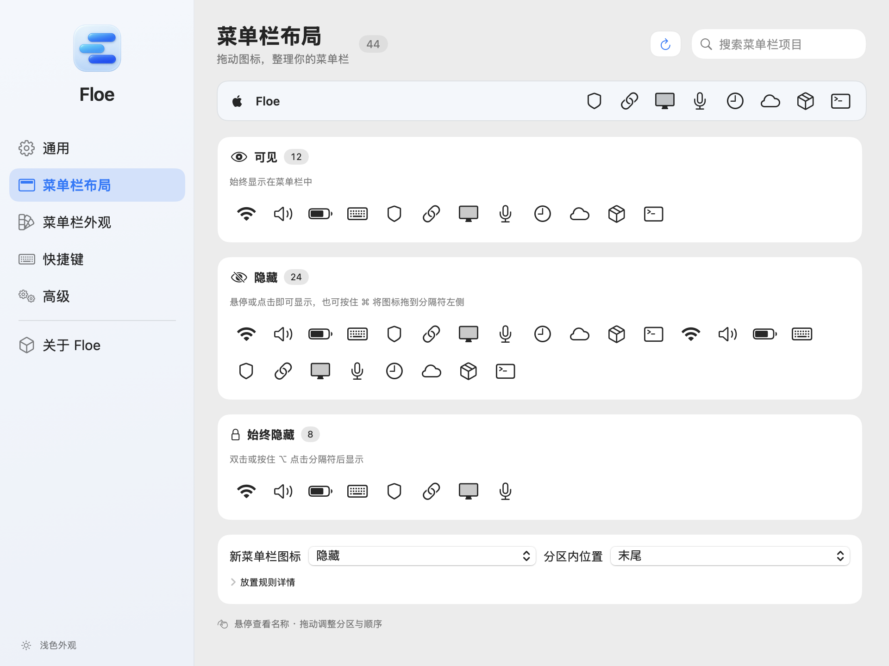

[English](README.md) · [简体中文](README.zh-CN.md)

<div align="center">
  
  <h1>Floe</h1>
  <p>让菜单栏更清爽，让图标各就其位。</p>
  <p>免费开源的 macOS 菜单栏管理工具。</p>
  <p><a href="https://github.com/wudb/Floe/releases">下载应用</a> · <a href="https://github.com/wudb/Floe/issues">反馈问题</a> · <a href="LICENSE">GPL-3.0 许可证</a></p>
</div>

**macOS 14 Sonoma 及以上** · **英语 / 简体中文** · **当前源码版本：1.0.0**

## 重新整理你的菜单栏

常用图标保持可见，偶尔使用的工具收进隐藏分区，需要时再展开。Floe 将紧凑的布局编辑器、独立浮栏和外观设置整合在同一个设置窗口中。

<picture>
  <source media="(prefers-color-scheme: dark)" srcset="docs/images/menu-bar-layout-dark-zh-c4f203fc.png">
  
</picture>

[浅色预览](docs/images/menu-bar-layout-light-zh-ba26e598.png) · [深色预览](docs/images/menu-bar-layout-dark-zh-c4f203fc.png)

*预览由 Floe 当前界面组件渲染，使用示例图标。图中为简体中文界面，应用也支持英语。*

## 开始使用

1. 从[发布页面](https://github.com/wudb/Floe/releases)下载 `Floe.zip`，解压后将 `Floe.app` 放入**应用程序**。
2. 打开 Floe，按提示授予权限。在**系统设置 → 隐私与安全性**中，为 Floe 开启**辅助功能**，用于管理菜单栏项目；开启**屏幕录制**，用于显示捕获的图标及使用外观功能。也可以稍后授权，可用功能取决于已授予的权限。
3. 右键点击菜单栏中的 Floe 图标，选择 **Floe 设置…**，进入**菜单栏布局**整理图标，在**通用**中选择外观、语言和登录时启动等选项。

当前发布流程采用 ad hoc 签名，尚未公证。若下载的构建首次启动受到 macOS 限制，可移除隔离属性后重新打开：

```bash
xattr -d com.apple.quarantine /Applications/Floe.app
```

目前通过[发布页面](https://github.com/wudb/Floe/releases)手动下载安装更新。

## 整理菜单栏图标

**菜单栏布局**页包含菜单栏预览和三个图标分组：

| 分组 | 显示方式 |
| --- | --- |
| **可见** | 始终显示在菜单栏中。 |
| **隐藏** | 展开隐藏分区时显示。 |
| **始终隐藏** | 通过单独的展开操作显示，需先在**高级**中启用该分区。 |

拖动图标可调整分组和顺序，悬停可查看名称，搜索框支持查找图标或应用。图标右键菜单提供移动操作，以及**始终显示此应用**规则。部分受系统保护的图标无法移动。

在页面底部，为**新菜单栏图标**选择默认分区，以及放在分区开头或末尾。已有图标保留已保存的位置。展开**放置规则详情**可查看规则说明，并使用**显示所有当前图标**。

在**通用**中，可启用点击、悬停或滚动来展开隐藏图标，并设置自动收起。在**快捷键**中，可配置展开分区、搜索项目和切换浮栏等操作。

通过 Floe 右键菜单中的**搜索菜单栏项目**或对应快捷键，还可以打开独立的项目搜索窗口。

## 选择隐藏图标的呈现方式

在**通用**中，为**隐藏分区**和**始终隐藏分区**分别选择：

| 方式 | 效果 |
| --- | --- |
| **原生菜单栏** | 在系统菜单栏中展开图标。 |
| **Floe 浮栏** | 在菜单栏下方打开独立浮栏。 |
| **跟随“使用 Floe 浮栏”** | 遵循**使用 Floe 浮栏**开关。 |
| **自适应** | 根据屏幕、全屏状态和可用空间规则选择呈现方式。 |

浮栏支持**横向图标**、**名称列表**和**图标网格**。列表和网格在内容较多时可滚动；网格支持设置 2–12 列，并适应较窄的屏幕。

右键点击浮栏背景，选择**整理**可调整图标顺序。退出整理模式后，拖动背景可移动浮栏，再通过**固定位置**记住该显示器上的位置。固定位置后，自动收起仍然生效。

展开**自适应呈现规则**，可选择屏幕类型、连接数量、预留菜单栏空间、全屏行为及按显示器手动覆盖。这些规则决定分区如何展开，图标分组保持原有设置。使用原生菜单栏展开始终隐藏分区时，也会露出隐藏分区，因为它们共用同一行。

## 按你的习惯设置

新版侧栏将各项功能放在独立页面中：

| 页面 | 可配置内容 |
| --- | --- |
| **通用** | 登录时启动、应用外观、语言、Floe 图标、展开方式、浮栏及图标间距。 |
| **菜单栏布局** | 图标分组、排序、搜索和新图标的默认位置。 |
| **菜单栏外观** | 菜单栏形状、端点圆角、纯色或渐变着色、模糊、边框和阴影。 |
| **快捷键** | 分区展开、项目搜索、浮栏及其他菜单栏操作的快捷键。 |
| **高级** | 始终隐藏分区、分隔符、展开延迟及其他行为选项。 |
| **关于 Floe** | 应用版本与项目链接。 |

**应用外观：**在**通用 → 外观**中选择**跟随系统**、**浅色**或**深色**，选择会保存并立即应用到 Floe 窗口与默认浮栏。菜单栏自身的样式可在**菜单栏外观**中单独调整。

**界面语言：**在**通用 → 语言**中选择**跟随系统**、**English**或**简体中文**，切换后无需重启。系统首选语言不受支持时回退为英语。

**菜单栏间距：**在通用设置中调整并应用。对于需要重新登录的 macOS 版本，Floe 会提示注销并重新登录后生效。

## 键盘操作

| 位置 | 按键 | 操作 |
| --- | --- | --- |
| 布局编辑器 | `Tab`，然后 `←` / `→` | 聚焦并选择图标。 |
| 布局编辑器 | `⌘←` / `⌘→` | 将当前图标向前或向后移动。 |
| 布局编辑器 | `⌘1` / `⌘2` / `⌘3` | 移至可见 / 隐藏 / 始终隐藏分区。 |
| 项目搜索 | `↑` / `↓` 或 `Control-P` / `Control-N` | 选择搜索结果。 |
| 项目搜索 | `Return` / `Escape` | 打开当前结果 / 关闭搜索。 |

布局编辑器的右键菜单及 VoiceOver 操作菜单也提供图标移动操作。

## 使用帮助

- **看不到某个图标：**检查 Floe 的系统权限，再刷新菜单栏布局。系统未提供或不允许移动的项目，部分操作可能受限。
- **找不到 Floe 图标：**从应用程序重新打开 Floe，再使用**通用 → 恢复 Floe 图标**。
- **重新构建或更新后权限失效：**重新检查 Floe 的授权状态，开发签名与权限排查方法见[脚本说明](script/README.md)。
- **卸载：**退出 Floe，将应用程序中的 `Floe.app` 移到废纸篓。

提交[问题反馈](https://github.com/wudb/Floe/issues)时，请附上 Floe 和 macOS 版本、显示器配置、复现步骤，以及有助于说明问题的截图。

## 构建与贡献

使用 **Xcode 26 或更新版本**。工程最低部署目标为 macOS 14；macOS 26 及以上使用 Liquid Glass，较早系统使用兼容材质。

```bash
git clone https://github.com/wudb/Floe.git
cd Floe
open Floe.xcodeproj
```

选择 **Floe** Scheme，配置自己的开发签名团队后运行。本地构建、发布打包和回归检查命令见[脚本说明](script/README.md)。

欢迎通过 [Issues](https://github.com/wudb/Floe/issues) 和 [Pull Requests](https://github.com/wudb/Floe/pulls)参与改进。修改可见文案时，请同步维护英语与简体中文资源。

## 许可证

Floe 采用 [GNU General Public License v3.0](LICENSE) 许可证。

## Star 历史

[](https://star-history.com/#wudb/Floe&Date)
